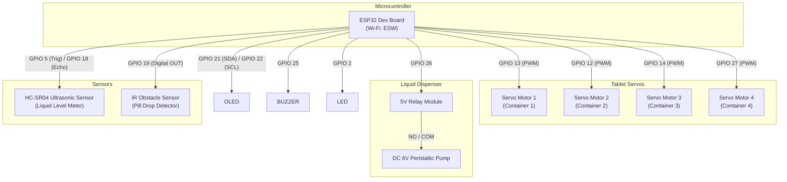
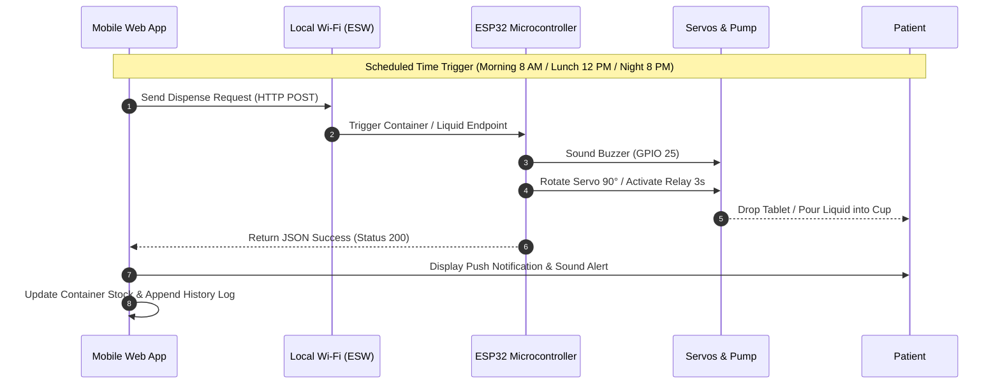

# Medi Tracker: 3D CAD Drawing & Mechanical Hardware Design Schematic
## Smart Medicine & Liquid Dispenser System (ESP32)

---

### 1. 3D Structural Layout & Dimensions

The Medi Tracker enclosure is designed for compact desktop or bedside installation.

```
       +-------------------------------------------------------------------+
       |                       TOP LIQUID & TABLET TOWER                   |
       |  +------------+  +------------+  +------------+  +------------+   |
       |  | CONTAINER 1|  | CONTAINER 2|  | CONTAINER 3|  | CONTAINER 4|   |
       |  | (Morning/  |  | (Amoxicillin|  | (Vitamin C)|  | (Aspirin)  |   |
       |  |  Night)    |  |  500mg)    |  |            |  |            |   |
       |  +-----+------+  +-----+------+  +-----+------+  +-----+------+   |
       |        |               |               |               |          |
       |  +-----+------+  +-----+------+  +-----+------+  +-----+------+   |
       |  | SERVO M1   |  | SERVO M2   |  | SERVO M3   |  | SERVO M4   |   |
       |  | (GPIO 13)  |  | (GPIO 12)  |  | (GPIO 14)  |  | (GPIO 27)  |   |
       |  +-----+------+  +-----+------+  +-----+------+  +-----+------+   |
       |        |               |               |               |          |
       |  ======v===============v===============v===============v======    |
       |                      SLOPED PILL DISPENSE CHUTE                   |
       +-------------------------------------------------------------------+
       |  [ OLED DISPLAY ]  [ ESP32 W-IFI MODULE ]   [ LIQUID NOZZLE ]     |
    |  (SSD1306 I2C)     (SSID: ESW)              (DC Pump - GPIO 26)   |
       |                                                    |              |
       |  [---------------- MAIN COLLECTION TRAY ----------------]         |
       +-------------------------------------------------------------------+
```

#### Physical Dimensions:
- **Total Width:** 320 mm
- **Total Height:** 220 mm
- **Total Depth:** 180 mm
- **Container Diameter:** 50 mm x Height 110 mm (Capacity: ~20-25 tablets each)
- **Liquid Reservoir Capacity:** 200 ml

---

### 2. Circuit Diagram & Wiring Connections



---

### 3. Component Bill of Materials (BOM)

| Component | Part / Model | Quantity | Purpose |
| :--- | :--- | :---: | :--- |
| **Microcontroller** | ESP32-WROOM-32U | 1 | Core CPU with Wi-Fi & Bluetooth |
| **Servo Motors** | TowerPro SG90 9g | 4 | Rotating tablet dispensing mechanism |
| **Liquid Pump** | 6V Peristaltic / Mini Pump | 1 | Liquid medicine dosage dispensing |
| **Ultrasonic Sensor**| HC-SR04 | 1 | Real-time liquid bottle level sensor |
| **Infrared Sensor** | IR Obstacle Sensor FC-51 | 1 | Tablet drop verification sensor |
| **Relay Driver** | 1-Channel 5V Relay | 1 | High-current isolation for liquid pump |
| **Display** | 0.96" I2C OLED SSD1306 | 1 | Local status and Wi-Fi IP display |
| **Audio Notification**| 5V Piezo Buzzer | 1 | Audible reminder sound when dispensing |
| **Power Supply** | 5V 3A DC Adapter | 1 | Main system power supply |
| **3D Printing Material**| PLA Filament | 450g | Enclosure, containers, and funnel chute |

---

### 4. Sequence Flowchart


